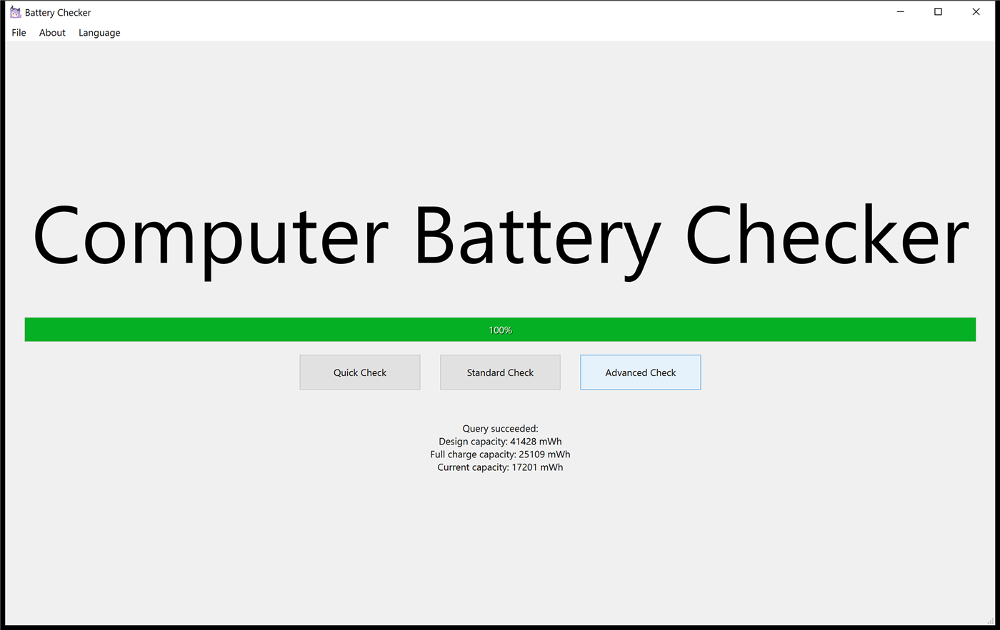

# Battery Checker · 电脑电量检测器

Windows 笔记本电池信息检测工具，基于 **Qt 6 Widgets + Windows SetupAPI / 电池 IOCTL** 直接读取电池的设计容量、满充容量与当前容量，不依赖 WMI 之外的任何第三方库。

<p align="center">
  
  
</p>

## 功能

- **三种检测模式**
  - `简单检测`：查询系统是否接电（Power present）
  - `普通检测`：查询当前电量百分比（`GetSystemPowerStatus`）
  - `高级检测`：通过 `IOCTL_BATTERY_QUERY_TAG / QUERY_INFORMATION / QUERY_STATUS` 读取
    设计容量、满充容量、当前容量（mWh）
- **相对单位自动识别**：电池上报 `BATTERY_CAPACITY_RELATIVE` 时，界面会明确标注“相对值，无法换算为 mAh/mWh”，不会拿假数据糊弄人
- **多电池接口遍历**：枚举全部电池设备接口，取第一块能读到数据的电池，而不是硬编码索引 0
- **中英双语**：默认跟随系统语言，可在菜单 `语言 / Language` 里随时切换，也可用命令行 `--lang=`
- **自适应界面**：纯 `QVBoxLayout/QHBoxLayout` 布局，标题字号按窗口实际空间自动计算，任意窗口尺寸、任意语言都不会截断文字
- **图标内嵌**：`icon.ico` 同时编进 Qt 资源（窗口/任务栏图标）和 exe 的 PE 资源（资源管理器图标），换工作目录启动也不会丢图标

## 下载

到 [Releases](../../releases) 下载 `Battery-Checker-win64.zip`，解压后双击 `Battery-Chker.exe` 即可，无需安装 Qt 运行时。

## 从源码构建

依赖：Qt 6.5+（MinGW 或 MSVC 均可）、CMake 3.19+、Ninja（可选）。

```bash
cmake -S . -B build -G Ninja -DCMAKE_BUILD_TYPE=Release -DCMAKE_PREFIX_PATH=D:/Qt/6.11.1/mingw_64
cmake --build build
```

生成精简发布包（`-Os` + LTO + `--gc-sections` + strip，只带必要的 Qt 运行时）：

```bat
deploy-min.bat
```

发布包会输出到 `dist/`。

## 命令行参数

| 参数 | 说明 |
| --- | --- |
| `--lang=zh_CN` | 以简体中文启动（忽略系统语言） |
| `--lang=en` | 以英文启动 |

## 项目结构

| 文件 | 说明 |
| --- | --- |
| `main.cpp` | 入口，设置应用图标、解析 `--lang=` |
| `mainwindow.ui` | 布局定义（标题 / 进度条 / 按钮行 / 结果区） |
| `mainwindow.cpp` | 检测逻辑、语言切换、标题字号自适应、结果渲染 |
| `mainwindow.h` | 主窗口类声明与 `ResultState` 状态枚举 |
| `resouces.qrc` | Qt 资源（图标、翻译 `.qm`） |
| `icon.rc` / `icon.ico` | exe 的 Windows 资源图标 |
| `Battery-Chker_zh_CN.ts` / `Battery-Chker_en.ts` | 翻译源文件，构建时由 `lupdate/lrelease` 编译进资源 |
| `deploy-min.bat` | 生成精简发布目录 `dist/` |
| `CMakeLists.txt` | 构建脚本 |

## 技术说明

- 电池枚举：`SetupDiGetClassDevs(&GUID_DEVCLASS_BATTERY, …)` + `SetupDiEnumDeviceInterfaces`
- 数据读取：`CreateFile(DevicePath)` 后走 `IOCTL_BATTERY_QUERY_TAG` → `BatteryInformation` → `BatteryStatus`
- 容量单位：`BATTERY_INFORMATION.Capabilities & BATTERY_CAPACITY_RELATIVE` 为 0 时单位是 mWh，
  否则是相对于设计容量的相对值
- 界面不阻塞：检测过程中的延时用嵌套 `QEventLoop` 实现，进度条可以正常刷新

## 已知限制

- 仅支持 Windows（依赖 SetupAPI 与电池 IOCTL）
- 台式机 / 无电池设备会返回“查询失败”
- 电池驱动未上报 `DesignedCapacity` 时显示 0
