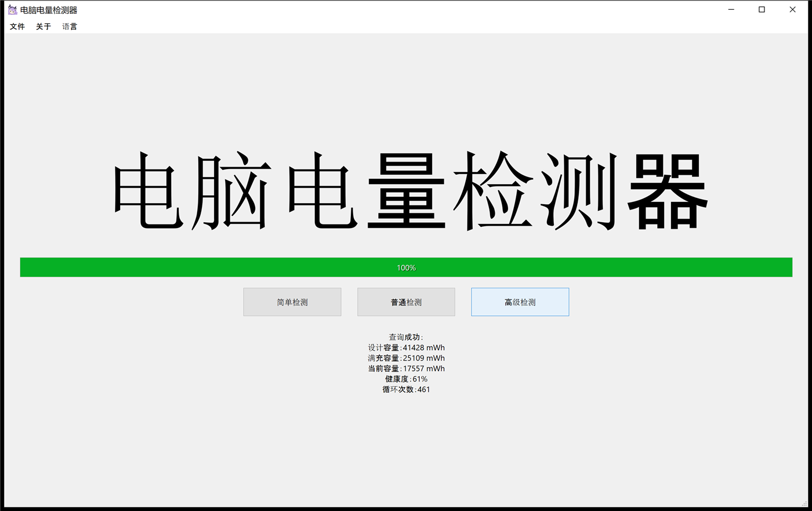

# Battery Checker · 电脑电量检测器

Windows 笔记本电池信息检测工具，基于 Qt6 + Windows API 直接读取电池的设计容量、满充容量与当前容量。

<p align="center">
  
  
</p>

## 功能

- **三种检测模式**
  - `简单检测`：也算做滚木
  - `普通检测`：查询当前电量百分比
  - `高级检测`：通过 `IOCTL_BATTERY_QUERY_TAG / QUERY_INFORMATION / QUERY_STATUS` 读取
    设计容量、满充容量、当前容量（mWh）、**健康度**、**循环次数**
## 下载

到 [Releases](../../releases) 下载 `Battery-Checker-win64.zip`，解压后双击 `Battery-Chker.exe` 即可，无需安装 Qt 运行时。

## 从源码构建

依赖：Qt 6.5+（MinGW 或 MSVC 均可）、CMake 3.19+、Ninja（可选）。

```bash
cmake -S . -B build -G Ninja -DCMAKE_BUILD_TYPE=Release -DCMAKE_PREFIX_PATH=D:/Qt/6.11.1/mingw_64
cmake --build build
```

生成精简发布包（`-Os` + LTO + `--gc-sections` + strip，只带必要的 Qt 运行时）：

```bat
deploy-min.bat
```

发布包会输出到 `dist/`。

## 命令行参数

| 参数 | 说明 |
| --- | --- |
| `--lang=zh_CN` | 以简体中文启动（忽略系统语言） |
| `--lang=en` | 以英文启动 |

## 项目结构

| 文件 | 说明 |
| --- | --- |
| `main.cpp` | 入口，设置应用图标、解析 `--lang=` |
| `mainwindow.ui` | 布局定义（标题 / 进度条 / 按钮行 / 结果区） |
| `mainwindow.cpp` | 检测逻辑、语言切换、标题字号自适应、结果渲染 |
| `mainwindow.h` | 主窗口类声明与 `ResultState` 状态枚举 |
| `resouces.qrc` | Qt 资源（图标、翻译 `.qm`） |
| `icon.rc` / `icon.ico` | exe 的 Windows 资源图标 |
| `Battery-Chker_zh_CN.ts` / `Battery-Chker_en.ts` | 翻译源文件，构建时由 `lupdate/lrelease` 编译进资源 |
| `deploy-min.bat` | 生成精简发布目录 `dist/` |
| `CMakeLists.txt` | 构建脚本 |
